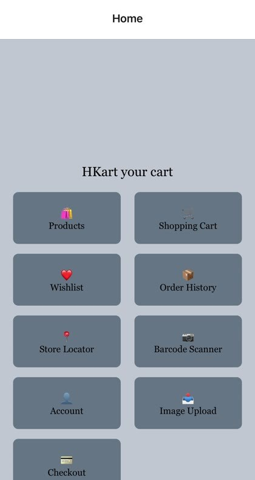
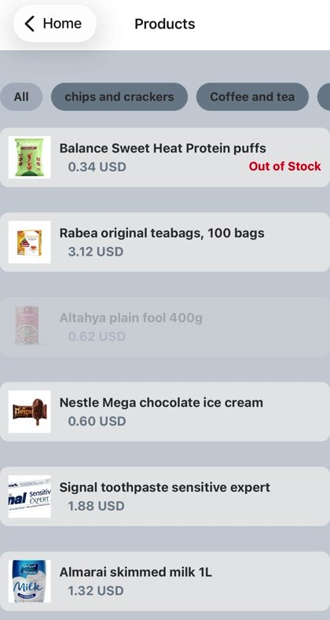
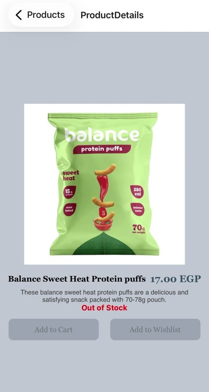
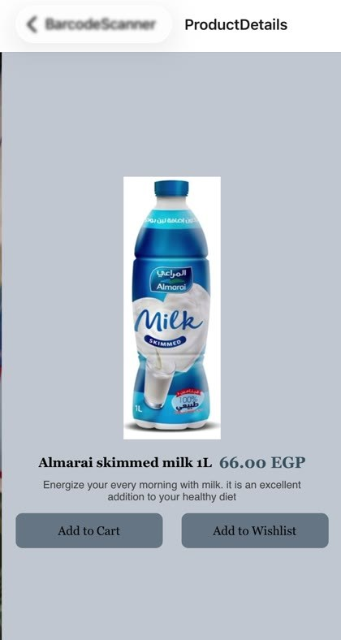
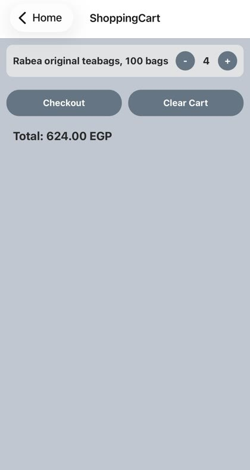
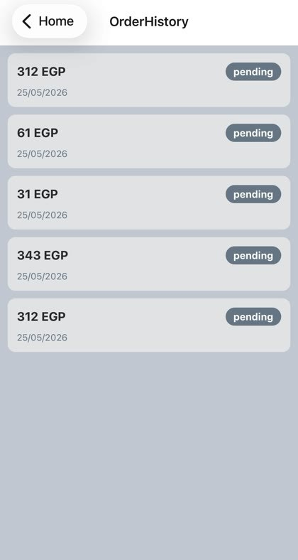
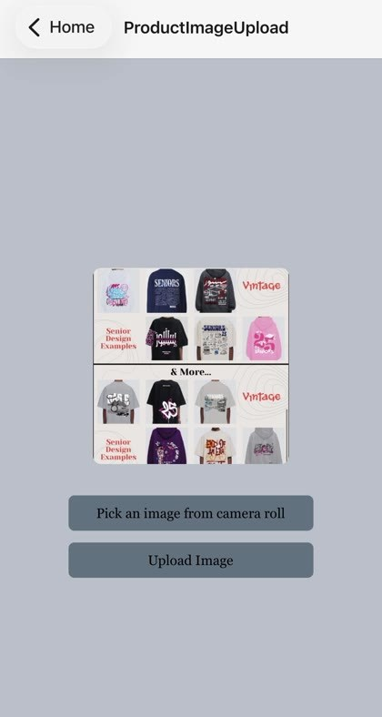
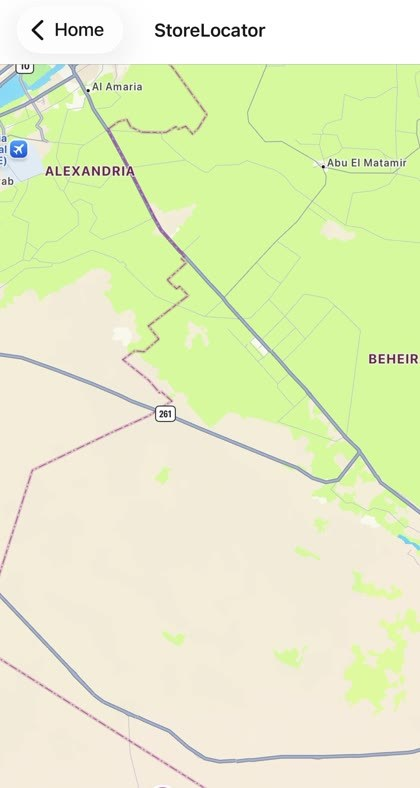
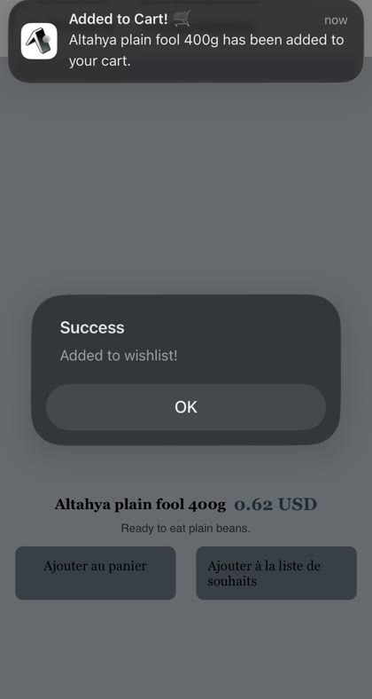
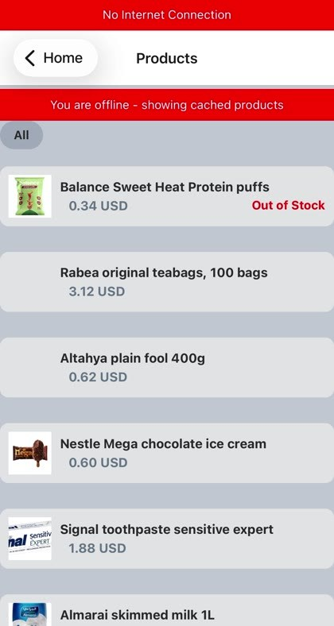

# HKart

A full-featured mobile shopping app built with **React Native, Expo and Supabase**. It covers the whole shopping journey, from sign-up and a product catalog to checkout and order history, and it uses phone features such as a barcode scanner, push notifications, GPS and offline support.

> Built independently as a course project (Scenario A: Shop App).

## Screenshots

<p align="center">
  
  
  
  
  
  
  
  
  
  
  
  
</p>

## Features

**Shopping**
- Registration and login with Supabase authentication
- Product list with category filters, product details and out-of-stock labels
- Shopping cart with quantity controls (Zustand)
- Wishlist
- Secure checkout with a PDF receipt export
- Order history
- Account page for updating profile details

**Phone features**
- Barcode scanner that opens the matching product
- Product image upload from the camera roll
- Store locator with GPS and an interactive map
- Push notifications, for example when an item is added to the cart
- Haptic feedback
- Deep linking (`hkart://`)

**Reliability**
- Offline browsing of cached products
- Network status banner
- Battery-aware sync

**Localization and display**
- English and French (i18n-js)
- Currency switch between EGP, USD, EUR and SAR
- Light and dark mode

## Tech stack

| Area | Technology |
| --- | --- |
| App | React Native, Expo SDK 54 |
| Navigation | React Navigation v6 |
| State | Zustand |
| Backend | Supabase (Auth, Database, Storage) |
| Device features | expo-camera, expo-image-picker, expo-location, react-native-maps, expo-notifications, expo-print, expo-sharing, expo-network, expo-battery, expo-haptics, expo-linking |
| Security | expo-secure-store with AES-encrypted session storage |
| Localization | expo-localization, i18n-js |

## Project structure

```
src/
  components/   Auth component
  context/      AuthContext
  hooks/        ShoppingCartStore (Zustand)
  lib/          Supabase client and secure storage
  navigation/   App navigation
  screens/      14 screens: Welcome, Register, Login, Home, Products, ProductDetails,
                ShoppingCart, Checkout, OrderHistory, Wishlist, BarcodeScanner,
                StoreLocator, ProductImageUpload, Account
schema.sql      Database schema
```

## Database

`schema.sql` creates seven tables:

| Table | Purpose |
| --- | --- |
| `products` | Name, description, price, category, image, barcode and stock quantity |
| `orders` | One row per order, with payment method, status and total price |
| `order_items` | Items in an order, with the price at the time of purchase |
| `shopping_cart` | Each user's cart |
| `wishlist` | Each user's saved products |
| `profiles` | Username, website and image |
| `stores` | Store name, address, phone and coordinates for the store locator |

## Getting started

**Prerequisites:** a recent LTS version of Node.js, a free [Supabase](https://supabase.com) project, and the Expo Go app or an emulator.

1. Clone the repository and install the dependencies:
   ```bash
   git clone https://github.com/hunia2004-wq/HKart.git
   cd HKart
   npm install
   ```
2. In the Supabase SQL editor, run `schema.sql` to create the tables.
3. Add your Supabase project details. `.env.example` lists the variable names (`EXPO_PUBLIC_SUPABASE_URL` and `EXPO_PUBLIC_SUPABASE_ANON_KEY`). In `src/lib/supabase.js`, set `supabaseUrl` and `supabasePublishableKey` to your own values.
4. Start the app:
   ```bash
   npm start
   ```
   Scan the QR code with Expo Go, or run `npm run android` or `npm run ios`.

## My contribution

I built the whole app on my own: the interface, the Supabase database and authentication, the cart and state management, and every phone feature above. I learned each native feature from the official documentation.

## Author

**Hunia Khattab**, AI Integration & Full-Stack Developer, Alexandria, Egypt.

[LinkedIn](https://www.linkedin.com/in/hunia-khattab-b831272a7/) · [GitHub](https://github.com/hunia2004-wq) · hunia2004@gmail.com
